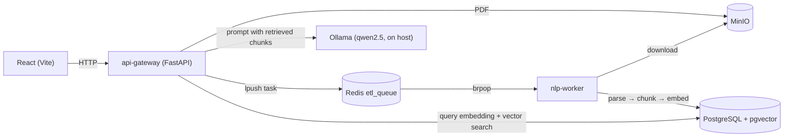

# Financial Report RAG Q&A

[](https://github.com/river910429/News_Analyzer_System/actions/workflows/ci.yml)

A Retrieval-Augmented Generation (RAG) system for financial reports. Upload PDF reports, let the system index them in the background, then ask questions in natural language and get answers from a **local LLM** together with the source passages they were based on.

財報問答系統：上傳財報 PDF，系統在背景建立向量索引，使用者以自然語言提問，由本地 LLM 根據檢索到的段落回答並附上來源。

<!-- TODO: add a screenshot / GIF of the UI here, e.g. docs/demo.gif -->

## Highlights

- **Hybrid retrieval with Chinese NLP fundamentals**: `bge-m3` vectors (pgvector) fused by RRF with BM25 over a **self-built inverted index** in PostgreSQL (CJK bigram postings, scored in SQL). Bigrams beat jieba, HanLP and CKIP word segmentation on this corpus (MRR 0.853 vs 0.744–0.762). Chinese numerals are annotated at index time (民國一一四年〔114年〕, 9萬557〔90,557〕), which fixed retrieval misses and misread figures.
- **Agent harness**: a tool-calling agent (search, page reader, safe calculator) wrapped in checks that do not need the answer key — arithmetic is recomputed and corrected, periods and numbers must appear in the retrieved text, lookup questions may not be answered with derived figures, tool calls written as text are parsed and run, and a guardrail abstains when the model ignores feedback. Multi-company questions: **0/14 → 9/14** with the same 7B model, each step backed by an error analysis in [`eval/README.md`](eval/README.md).
- **QLoRA distillation** ([`lora/`](lora/README.md)): 14B teacher trajectories on *other* companies' reports, rejection-sampled and repaired, used to fine-tune Qwen2.5-7B (4-bit, 0.53 % trainable parameters), exported to GGUF Q4_K_M for Ollama. Held-out companies: 18/26 → **20/26**, faster answers, consistent abstention.
- **Multi-company**: company recognition and entity linking in questions, company-filtered retrieval with per-company interleaving.
- **Kubernetes**: Docker Desktop cluster, KEDA autoscaling of indexing workers on Redis queue length, graceful scale-in, probes, PVCs ([`k8s/`](k8s/README.md)).
- **MCP server** exposing `list_documents`, `search_report`, `get_page` to any MCP client; **SSE streaming** (first token ≈ 0.5 s).
- **Evaluation and CI**: retrieval (Hit@k, MRR), agent answer accuracy and harness interventions; 80+ unit tests, ruff, GitHub Actions with a Postgres service. Everything runs locally, no API keys.

## Architecture



**Indexing (async)**
1. `POST /upload` stores the PDF in MinIO, inserts a `pending` row in `documents`, and pushes a task to Redis.
2. `nlp-worker` pops the task, extracts text with `pypdf`, splits it into 500-char chunks with 50-char overlap, embeds them with `bge-m3`, and writes them to `document_chunks`. Chunks and the `completed` status are committed in one transaction, so a failed document never becomes partially searchable.

**Question answering**
1. `POST /search` embeds the question with the same model and retrieves the top-k chunks by cosine similarity.
2. Chunks below the similarity threshold (default 0.4) are dropped. If nothing is left, the API answers "not found" without calling the LLM.
3. The remaining chunks are put into a Traditional Chinese prompt that instructs the model to answer **only** from the provided context.

## Tech Stack

| Layer | Technology |
|---|---|
| Frontend | React 18, Vite, Tailwind CSS |
| API | FastAPI, Pydantic |
| Queue | Redis (list as a simple task queue) |
| Worker | Python, pypdf, sentence-transformers |
| Storage | PostgreSQL 16 + pgvector, MinIO (S3-compatible) |
| LLM | Ollama (`qwen2.5`) running on the host |
| Infra | Docker Compose |

## Getting Started

### Prerequisites

- Docker and Docker Compose
- [Ollama](https://ollama.com/) running on the host machine, with the model pulled:

  ```bash
  ollama pull qwen2.5
  ```

- About 4 GB of free RAM for the embedding model (the first start downloads `bge-m3`, ~2 GB)

### Run

```bash
git clone https://github.com/river910429/News_Analyzer_System.git
cd News_Analyzer_System
cp .env.example .env        # adjust passwords if you like
docker-compose up --build
```

| Service | URL |
|---|---|
| Web UI | http://localhost:5173 |
| API docs (Swagger) | http://localhost:8000/docs |
| MinIO console | http://localhost:9001 |

Upload a PDF in the sidebar, wait until its status becomes `completed`, select it, and ask a question such as 「營收表現如何？」.

## API

| Method | Path | Description |
|---|---|---|
| `POST` | `/upload` | Upload a PDF (multipart `file`); queues it for indexing |
| `GET` | `/documents` | List documents and their indexing status |
| `POST` | `/search` | `{"query": "...", "top_k": 5}` → `{"answer": "...", "sources": [...]}` |
| `POST` | `/search/stream` | Same input; answer streamed as Server-Sent Events (`sources`, `token`…, `done` with time-to-first-token) |
| `POST` | `/retrieve` | Retrieval only (no LLM), used by the evaluation script |
| `POST` | `/documents/{id}/reindex` | Re-run parsing, chunking and embedding for a document |
| `POST` | `/agent` | `{"question": "..."}` → `{"answer", "steps": [{"tool", "arguments", "result"}], "stopped_reason"}` |
| `GET` | `/documents/{id}/pages/{page}` | Full text of one page |
| `GET` | `/documents/{id}/chunks` | All chunks of a document (offline experiments) |
| `POST` | `/documents/reindex` | Re-index every document |
| `DELETE` | `/documents/{id}` | Delete a document, its chunks, postings and stored PDF |
| `GET` | `/health` | DB and Redis status |

## Kubernetes

The stack also runs on Kubernetes (Docker Desktop) with **KEDA autoscaling the indexing workers on the Redis queue length**, graceful scale-in, probes, PVCs and a shared model cache. See [`k8s/README.md`](k8s/README.md).

## MCP

The `mcp-server` service (streamable HTTP, port 8001) wraps the API as MCP tools.
Connect Claude Code to it:

```bash
claude mcp add --transport http financial-rag http://localhost:8001/mcp
```

Then ask, for example, "用 financial-rag 查台積電 114 年毛利率比前一年增加多少". Or inspect the tools with
`npx @modelcontextprotocol/inspector` and the URL above.

## Evaluation

Details, failure analyses and every intermediate result: [`eval/README.md`](eval/README.md), [`lora/README.md`](lora/README.md).

**Retrieval** (2025 annual reports; three reports indexed, company filter, numeral annotation):

| | Hit@1 | Hit@5 | MRR |
|---|---|---|---|
| TSMC, 43 questions — baseline (500-char chunks, vector only, one report) | 0.581 | 0.884 | 0.719 |
| TSMC, 43 questions — final | 0.698 | 0.953 | 0.818 |
| MediaTek + UMC, 42 questions — final | 0.690 | 0.976 | 0.801 |

**Agent** (multi-step questions: two facts + a calculation, cross-company comparisons, unanswerable questions):

| Same harness | multi-company 14 | TSMC 12 | total | s / answer |
|---|---|---|---|---|
| qwen2.5 7B | 8/14 | 10/12 | 18/26 | 4.4 / 3.1 |
| qwen2.5 7B + QLoRA (distilled) | 10/14 | 10/12 | 20/26 | 3.6 / 2.9 |
| qwen2.5 14B | 12/14 | 11/12 | 23/26 | 6.2 / 4.8 |

Harness development on the multi-company set with 7B: 0/14 (schema-shaped tool arguments) → 4/14
(arguments unwrapped) → 6/14 (arithmetic / period / derivation checks) → 9/14 (grounding fix,
arithmetic correction, numeral annotation). An earlier 10/12 on the TSMC set turned out to be
inflated by a prompt example containing a test answer; it was removed and re-measured.

## Testing

```bash
pip install -r requirements-dev.txt
ruff check .
pytest
```

Unit tests cover chunking, tokenization, numeral annotation, BM25 / rank fusion, the agent
harness checks (with real failing answers from the evaluation runs), fine-tuning data
formatting, evaluation metrics, and the API. ML models are stubbed, so tests run in about a second without Docker.
GitHub Actions runs lint + tests and builds every service image on each push.

## Configuration

All settings come from environment variables; see [`.env.example`](.env.example). Notable ones:

| Variable | Default | Notes |
|---|---|---|
| `EMBEDDING_MODEL` | `BAAI/bge-m3` | Must be the same for gateway and worker; the DB column is `vector(1024)` |
| `SIMILARITY_THRESHOLD` | `0.4` | Minimum cosine similarity for a chunk to be used as context |
| `CHUNK_SIZE` / `CHUNK_OVERLAP` | `500` / `50` | Characters per chunk / overlap |
| `OLLAMA_URL` / `OLLAMA_MODEL` | `http://host.docker.internal:11434` / `qwen2.5` | LLM endpoint and model |
| `VITE_API_URL` | `http://localhost:8000` | API URL used by the browser |

## Design Decisions

- **Queue-based indexing.** PDF parsing and embedding take seconds to minutes. Moving them to a worker keeps `/upload` fast and lets the worker scale independently of the API.
- **pgvector instead of a dedicated vector DB.** Documents, metadata and vectors live in one PostgreSQL database, so joins (chunk → filename) are plain SQL and there is one less service to operate.
- **`bge-m3` embeddings.** Financial reports here are mostly Traditional Chinese with English terms mixed in; `bge-m3` is a strong multilingual model that runs on CPU.
- **Local LLM via Ollama.** No API keys or per-request cost, and documents never leave the machine.
- **Similarity threshold + strict prompt.** Both aim to reduce hallucination: weak matches are not sent to the LLM, and the prompt tells it to say "unknown" rather than guess.

## Project Structure

```
.
├── docker-compose.yml, init.sql, .env.example
├── services/
│   ├── api-gateway/   # FastAPI: upload, hybrid retrieval, RAG + SSE, agent harness (agent.py)
│   ├── nlp-worker/    # queue consumer: parse → chunk (+ tables) → annotate → embed → postings
│   ├── mcp-server/    # MCP tools over the API
│   └── frontend/      # React: upload, streaming chat, agent trace
├── k8s/               # manifests, KEDA ScaledObject, deploy.ps1
├── eval/              # QA sets, run_eval.py, tokenizer / ingest benchmarks, results/
├── lora/              # question generation, teacher trajectories, QLoRA training, GGUF export
└── tests/
```
